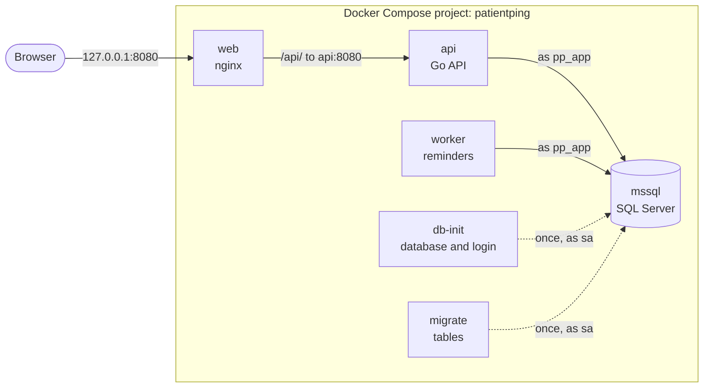

# PatientPing

A hands-on DevOps project: an appointment reminder service and the infrastructure around it, built up step by step from a laptop to AWS. Built by Faris Omerbasic while learning DevOps and SRE. The steps are numbered days, so "Day 17" in the docs means the step in which something was added.

Clinics store patients and appointments through a Go API backed by SQL Server, and a worker sends a reminder before each appointment. The app is kept small on purpose. The work is in everything around it: containers, CI/CD, AWS, infrastructure as code and monitoring, with Kubernetes after that.

## How it fits together



- `web` (nginx) is the only service with a published port, `127.0.0.1:8080`. It serves the page from `web/public` and passes everything under `/api/` to the API, which has no published port of its own.
- `api` and `worker` are two programs from the same Go image. The API answers the page's requests. The worker checks every 30 seconds for appointments that start within 24 hours and logs a reminder for each. Both connect as `pp_app`, a login that can only read and write data.
- `db-init` and `migrate` run once on every start and exit with 0. `db-init` creates the database and the `pp_app` login (`migrations/000_bootstrap.sql`), and `migrate` applies the numbered migrations in `migrations/`. `api` and `worker` start only after both have finished.
- SQL Server keeps its data in the named volume `pp-mssql`, so the data survives `make down`.

## Run locally

You need Docker with Compose v2 (Docker Desktop, or Docker Engine with the Compose plugin), `make`, `git` and `openssl`. The commands are for Linux or WSL. Go isn't needed, because the image is built inside Docker. SQL Server alone uses about 1.4 GB of memory.

```bash
git clone https://github.com/FarisOmerbasic/patientping.git
cd patientping
cp .env.example .env
```

`.env` holds the database passwords and is never committed. Generate them, so nobody has to invent or type one:

```bash
sed -i '/^MSSQL_SA_PASSWORD=/d; /^PP_DB_PASSWORD=/d' .env
echo "MSSQL_SA_PASSWORD=Pp1-$(openssl rand -hex 16)" >> .env
echo "PP_DB_PASSWORD=Pp1-$(openssl rand -hex 16)" >> .env
```

SQL Server wants upper and lower case letters, digits and a symbol, hence the `Pp1-` in front. The rest is only letters and digits, because the password also goes into a connection URL.

Start the stack and watch it come up:

```bash
make up
docker compose ps -a
```

The first start downloads SQL Server and takes a few minutes. The stack is ready when `mssql`, `api`, `worker` and `web` show `(healthy)`, and `db-init` and `migrate` show `Exited (0)`. Then open http://localhost:8080, or ask the API through nginx:

```bash
curl -s localhost:8080/api/patients
```

A new database answers `[]`.

`make down` stops the stack and removes the containers, and the data stays in the volume. `docker compose down -v` deletes the data too.

Before a commit, `make ci` runs the lint, the tests and the image build, and `make help` lists all targets. The checks need Go 1.27, `shellcheck` and `hadolint`, and `scripts/bootstrap.sh` installs the tools on Ubuntu. They also need Docker running, because `make lint` runs two tools in containers: actionlint checks the workflow files, and gitleaks scans every commit in the history for secrets. The pre-commit hook (gitleaks and shellcheck) is turned on once per clone with `git config core.hooksPath .githooks`.

## How a change reaches `main`

`main` only changes through a pull request. The ruleset in [`.github/rulesets/protect-main.json`](.github/rulesets/protect-main.json) requires the checks `lint`, `test` and `build` from [`ci.yml`](.github/workflows/ci.yml) to pass, keeps the history linear (squash merges), and blocks force pushes and deleting the branch. [`protect-release-tags.json`](.github/rulesets/protect-release-tags.json) keeps the release tags (`v*`) from being moved or deleted. Secret scanning and push protection are on too.

GitHub doesn't read these files. They record what is set, and an edited file is applied with `gh api -X PUT repos/FarisOmerbasic/patientping/rulesets/<id> --input <file>`, where `gh api repos/FarisOmerbasic/patientping/rulesets` lists the ids.

## Docs

- [`docs/runbooks/`](docs/runbooks/): what to do, step by step, when something known goes wrong.
- [`docs/adr/`](docs/adr/): design decisions, and why they were made.
- [`docs/results.md`](docs/results.md): measured numbers, each with its target.
- [`docs/postmortems/`](docs/postmortems/): write-ups after incidents (only the template so far).

## Where it's heading

| Phase | What gets built | Release |
|---|---|---|
| 1 | Go API and worker, Docker and Compose, CI/CD with GitHub Actions, deployment to AWS EC2 through SSM, Terraform, Prometheus, Grafana and CloudWatch alerting | `v1.0.0` |
| 2 | Migration from EC2 to Kubernetes (EKS), Helm, GitOps with Argo CD, SLOs, upgrade exercises | `v2.0.0` |
| 3 | Ansible, Azure, Windows Server, SQL Server operations, SRE practices | `v3.0.0` |
