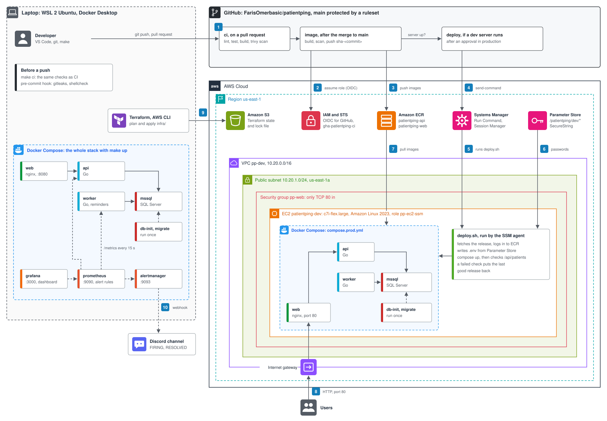
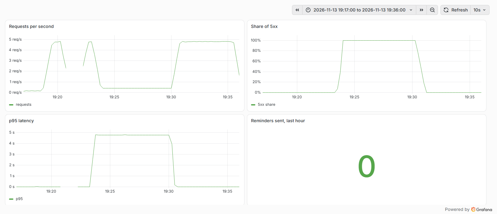
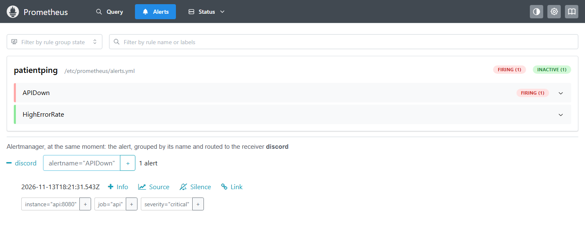
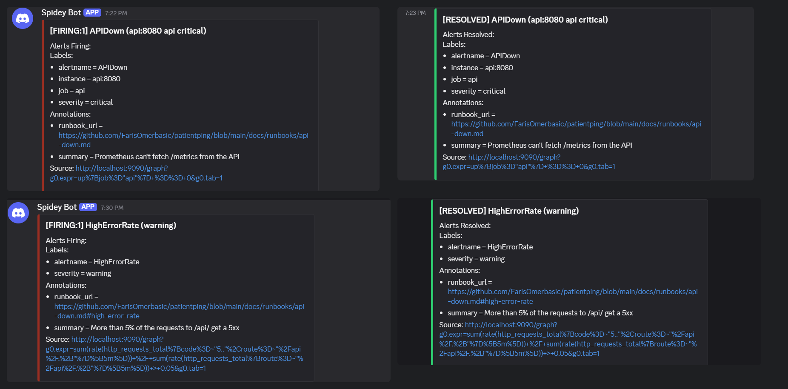
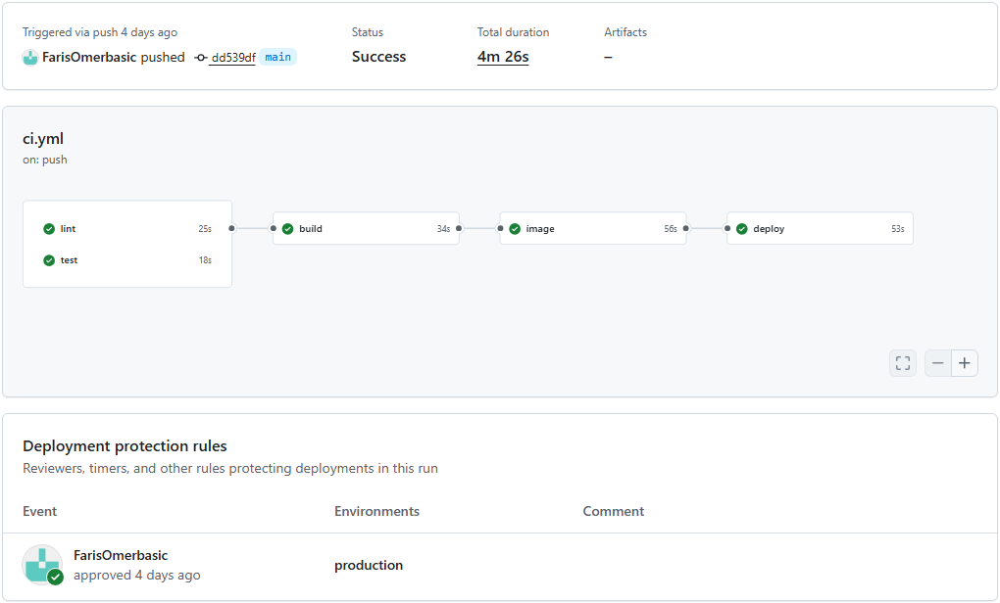
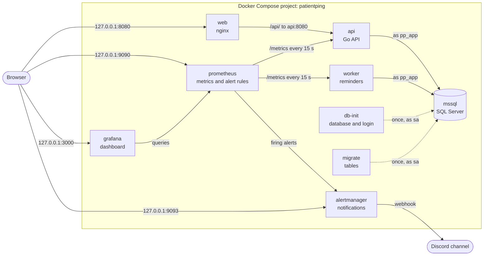

# PatientPing

[](https://github.com/FarisOmerbasic/patientping/actions/workflows/ci.yml)
[](https://github.com/FarisOmerbasic/patientping/releases)
[](LICENSE)

Clinics store patients and appointments through a Go API backed by SQL Server, and a worker sends a reminder before each appointment. The app is kept small on purpose. The work is in everything around it: containers, CI/CD, AWS, infrastructure as code and monitoring, with Kubernetes after that.

**Tools:** Bash, Go, Docker and Compose, nginx, SQL Server, GitHub Actions, AWS (EC2, ECR, S3, IAM, Systems Manager), Terraform, Prometheus, Alertmanager, Grafana.

## Architecture



1. A pull request runs `ci`: the lint, the tests, both image builds and a trivy scan. `main` only changes through a pull request with all three checks green.
2. After the merge, the `image` job trades the OIDC token that GitHub signs for it at STS for one-hour keys of the role `gha-patientping-ci`. No AWS key is stored in GitHub.
3. It pushes both images to ECR, tagged `sha-<commit>`, a tag that can't be overwritten.
4. When a dev server runs, the `deploy` job waits for an approval in the environment `production`, then sends `deploy.sh` to the server through Run Command. With no server, it's skipped.
5. The SSM agent on the server runs `deploy.sh` as root. The server has no SSH and no keys on it, and Session Manager gives a shell when one is needed.
6. `deploy.sh` writes the passwords from Parameter Store into `.env`, with the server's own role `pp-ec2-ssm`.
7. It pulls the images from ECR, starts the stack, and checks `/api/patients` through nginx. A failed check puts the last good release back.
8. Users reach nginx on port 80 through the internet gateway. The security group lets nothing else in.
9. Terraform on the laptop builds the network, the role and the server, and keeps its state in S3 with a lock file.
10. On the laptop, Prometheus fetches the metrics every 15 seconds, Grafana draws them, and Alertmanager sends the alerts to Discord.

## What's in it

| Area | What it does | Where |
|---|---|---|
| Linux and Bash | Scripts in strict mode, with a `usage()`, exit codes that mean something (0 healthy, 1 failed, 2 wrong usage) and `shellcheck` in CI: a health check with retries and timeouts, a log report, a system summary, and the installer for the tools. A systemd service and timer run the health check every minute. | [`scripts/`](scripts/), [`deploy/systemd/`](deploy/systemd/) |
| The app | A Go API and a worker from one image, with health and readiness endpoints, a clean shutdown on `SIGTERM`, JSON logs, Prometheus metrics, and numbered SQL migrations. | [`app/`](app/), [`migrations/`](migrations/) |
| Containers | Multi-stage builds whose images run as non-root users, checked by `hadolint`. The API image is 10.2 MB. Compose runs nine services, and SQL Server, the database setup and the migrations come up first, in order, by their health checks. | [`app/Dockerfile`](app/Dockerfile), [`web/Dockerfile`](web/Dockerfile), [`compose.yaml`](compose.yaml) |
| Continuous integration | Every pull request runs the lint (shellcheck, hadolint, go vet, actionlint, gitleaks, promtool, amtool), the tests, and both image builds with a trivy scan that stops on a critical finding. `main` only changes through a pull request with all three checks green. | [`ci.yml`](.github/workflows/ci.yml), [`.github/rulesets/`](.github/rulesets/) |
| AWS and Terraform | A VPC with a public subnet, a security group that lets in only port 80, and an EC2 server with no SSH and no keys on it: Systems Manager is the way in, and its role gets short-lived credentials to pull the images and read its own parameters. Terraform keeps its state in S3 with a lock file, and a pull request that touches `infra/` runs `fmt`, `validate` and tflint. | [`infra/`](infra/) |
| Delivery | After a merge, the images go to ECR, with AWS access through OIDC and no stored keys. An approved deploy runs `deploy.sh` on the server through Run Command, checks `/api/patients` through nginx, and puts the last good release back by itself when the check fails. | [`deploy/deploy.sh`](deploy/deploy.sh), [the runbook](docs/runbooks/deploy-and-rollback.md) |
| Monitoring | Prometheus collects the metrics of the API and the worker, a Grafana dashboard is stored as code, and two alert rules with unit tests go through Alertmanager to Discord, each with a link to its runbook. | [`observability/`](observability/), [`docs/observability.md`](docs/observability.md) |

## In numbers

Measured, each with its method in [`docs/results.md`](docs/results.md):

| What | Result |
|---|---|
| API image | 10.2 MB packed; the first, naive build was 346 MB |
| CI on a pull request | 1 min 8 s for the lint, the tests, two image builds and the scan |
| Deploy, from the approval to a healthy release | 53 s |
| Automatic rollback, from the failed check to the old release answering | 30 s |
| Dev environment with Terraform: the network, the role and the server | 12 resources, `apply` and `destroy` in 32 s each |
| Alert after the API stops | in Discord about 2 minutes later |

## See it running

Nothing runs on AWS between work sessions: the dev environment is built with Terraform when it's needed and destroyed afterwards, so there's no address to visit. These are from the real stack and the real pipeline.

**The dashboard during a drill.** The API was stopped until `APIDown` fired, about a minute and a half (the gap in requests per second). Then SQL Server was stopped for seven minutes during a loop of requests: every request waited about 4 seconds for its error, so the rate fell, the share of 5xx went to 100% and p95 to about 4.8 seconds, and `HighErrorRate` fired. Everything went back to normal once SQL Server was started again.



**An alert firing.** With the API stopped, Prometheus's alerts page shows `APIDown` firing, and Alertmanager holds it for the Discord receiver, with the labels that say where and how bad.



**What arrives in Discord.** From the same drill: each alert's `FIRING` message says what is broken, how bad it is, a sentence in plain words and the runbook to open, and its `RESOLVED` message comes by itself when the alert ends.



**A deploy through the pipeline.** [The first one](https://github.com/FarisOmerbasic/patientping/actions/runs/42703562305): `lint` and `test`, then `build`, `image` and `deploy`, which waited for an approval in the environment `production`.



[The rollback drill](https://github.com/FarisOmerbasic/patientping/actions/runs/42877906688) deployed a release with a wrong port in `nginx.conf` on purpose. Its `deploy` job is red: `deploy.sh` put the last good release back in 30 seconds and still reported the failure. The logs of both runs need a GitHub sign-in.

A live demo takes about two minutes to bring up: `terraform apply` (32 s) and an approved deploy (53 s).

## How the Compose stack fits together



- `web` (nginx) is the way in, on `127.0.0.1:8080`. It serves the page from `web/public` and passes everything under `/api/` to the API, which has no published port of its own.
- `api` and `worker` are two programs from the same Go image. The API answers the page's requests. The worker checks every 30 seconds for appointments that start within 24 hours and logs a reminder for each. Both connect as `pp_app`, a login that can only read and write data.
- `prometheus` fetches `/metrics` from `api`, `worker` and itself every 15 seconds (`observability/prometheus.yml`). The API counts and times every request by route pattern, method and status code, and the worker counts the reminders it sends. nginx doesn't pass `/metrics` on, so the numbers stay inside the Compose network.
- `grafana` draws them on the `PatientPing` dashboard: requests per second, the share of 5xx answers, p95 latency and reminders sent. Its data source and the dashboard come from files in `observability/grafana/`, so a new container has them with no clicks. The queries are explained in [`docs/observability.md`](docs/observability.md).
- `prometheus` also checks two alert rules every 15 seconds (`observability/alerts.yml`): `APIDown` when it can't fetch the API's `/metrics` for a minute, and `HighErrorRate` when more than 5% of the requests to `/api/` get a 5xx for 5 minutes. `alertmanager` sends the alerts that fire, and later their "resolved", to a Discord channel, each with a link to [the runbook](docs/runbooks/api-down.md).
- Besides `web`, only the pages of Prometheus (`127.0.0.1:9090`), Alertmanager (`127.0.0.1:9093`) and Grafana (`127.0.0.1:3000`) are published, and only on the laptop's own address.
- `db-init` and `migrate` run once on every start and exit with 0. `db-init` creates the database and the `pp_app` login (`migrations/000_bootstrap.sql`), and `migrate` applies the numbered migrations in `migrations/`. `api` and `worker` start only after both have finished.
- SQL Server keeps its data in the named volume `pp-mssql`, so the data survives `make down`.

## Run locally

You need Docker with Compose v2 (Docker Desktop, or Docker Engine with the Compose plugin), `make`, `git` and `openssl`. The commands are for Linux or WSL. Go isn't needed, because the image is built inside Docker. SQL Server alone uses about 1.4 GB of memory.

```bash
git clone https://github.com/FarisOmerbasic/patientping.git
cd patientping
cp .env.example .env
```

`.env` holds the database passwords and is never committed. Generate them, so nobody has to invent or type one:

```bash
sed -i '/^MSSQL_SA_PASSWORD=/d; /^PP_DB_PASSWORD=/d' .env
echo "MSSQL_SA_PASSWORD=Pp1-$(openssl rand -hex 16)" >> .env
echo "PP_DB_PASSWORD=Pp1-$(openssl rand -hex 16)" >> .env
```

SQL Server wants upper and lower case letters, digits and a symbol, hence the `Pp1-` in front. The rest is only letters and digits, because the password also goes into a connection URL.

Start the stack and watch it come up:

```bash
make up
docker compose ps -a
```

The first start downloads SQL Server and takes a few minutes. The stack is ready when `mssql`, `api`, `worker` and `web` show `(healthy)`, and `db-init` and `migrate` show `Exited (0)`. Then open http://localhost:8080, or ask the API through nginx:

```bash
curl -s localhost:8080/api/patients
```

A new database answers `[]`.

Prometheus's page is http://localhost:9090. Under *Status*, *Target health* lists `api`, `worker` and `prometheus` as UP, and the query `rate(http_requests_total[1m])` shows the API's requests per second.

Grafana's page is http://localhost:3000. Log in with `admin` / `admin` (Grafana's default, fine only because the page listens on `127.0.0.1`) and choose *Skip* for the new password. *Dashboards*, *PatientPing* shows the four panels.

The alerts go to a Discord channel. To get them, save the webhook URL of a channel of your own as the only line of `observability/discord.url`, which Git ignores, then `docker compose up -d --force-recreate alertmanager` (the steps, and a test message, are in [`docs/observability.md`](docs/observability.md#discord)). Without the file, `make up` makes it empty, and Alertmanager runs but sends nothing.

`make down` stops the stack and removes the containers, and the data stays in the volume. `docker compose down -v` deletes the data too.

Before a commit, `make ci` runs the lint, the tests, the two image builds and the vulnerability scan, and `make help` lists all targets. The checks need Go 1.27, `shellcheck`, `hadolint` and `trivy`, and `scripts/bootstrap.sh` installs the tools on Ubuntu. They also need Docker running, because `make lint` runs four tools in containers: promtool and amtool check the Prometheus and Alertmanager files and run the alert rules' unit tests, actionlint checks the workflow files, and gitleaks scans every commit in the history for secrets. The pre-commit hook (gitleaks and shellcheck) is turned on once per clone with `git config core.hooksPath .githooks`.

## How a change reaches `main`

`main` only changes through a pull request. The ruleset in [`.github/rulesets/protect-main.json`](.github/rulesets/protect-main.json) requires the checks `lint`, `test` and `build` from [`ci.yml`](.github/workflows/ci.yml) to pass, keeps the history linear (squash merges), and blocks force pushes and deleting the branch. [`protect-release-tags.json`](.github/rulesets/protect-release-tags.json) keeps the release tags (`v*`) from being moved or deleted. Secret scanning and push protection are on too.

GitHub doesn't read these files. They record what is set, and an edited file is applied with `gh api -X PUT repos/FarisOmerbasic/patientping/rulesets/<id> --input <file>`, where `gh api repos/FarisOmerbasic/patientping/rulesets` lists the ids.

`build` also builds both images and scans them with trivy, so a known critical vulnerability stops the pull request. After the merge, the `image` job on `main` builds them again, scans them, and pushes them to the Amazon ECR repositories `patientping-api` and `patientping-web`, tagged `sha-<commit>` and `latest`. Each `sha-` tag is pushed once, so it always names the image built from that commit.

No AWS key is stored in GitHub. The `image` job trades the OIDC token that GitHub signs for each job for the IAM role `gha-patientping-ci`, whose trust policy only accepts a token from a push to `main` in this repository, and whose keys last one hour. The role may log in to ECR and push to the two repositories, nothing else. Its ARN, the region and the registry are repository variables, not secrets, because none of them gives access by itself. The role and its two policies are in [`infra/shared/`](infra/shared/github-oidc.tf) and [`infra/policies/`](infra/policies/README.md).

Up to commit `b95496b`, the images went to GHCR (`ghcr.io/farisomerbasic/patientping-api` and `-web`). Those packages are no longer updated, so their `latest` stays at that commit.

## Docs

- [`docs/runbooks/`](docs/runbooks/): what to do, step by step, when something known goes wrong.
- [`docs/adr/`](docs/adr/): design decisions, and why they were made.
- [`docs/results.md`](docs/results.md): measured numbers, each with its target.
- [`docs/postmortems/`](docs/postmortems/): write-ups after incidents (only the template so far).

## Where it's heading

| Phase | What gets built | Release |
|---|---|---|
| 1 | Go API and worker, Docker and Compose, CI/CD with GitHub Actions, deployment to AWS EC2 through SSM, Terraform, Prometheus, Grafana and CloudWatch alerting | `v1.0.0` |
| 2 | Migration from EC2 to Kubernetes (EKS), Helm, GitOps with Argo CD, SLOs, upgrade exercises | `v2.0.0` |
| 3 | Ansible, Azure, Windows Server, SQL Server operations, SRE practices | `v3.0.0` |
